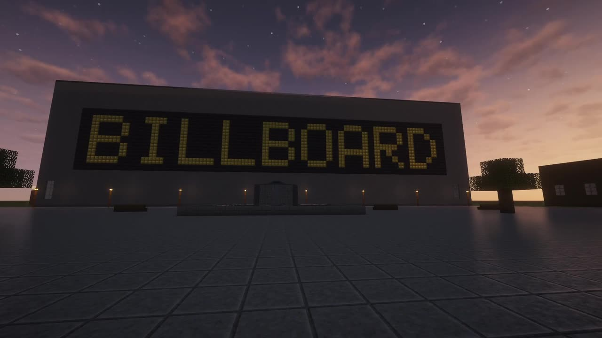
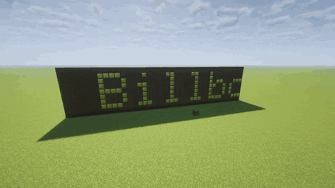
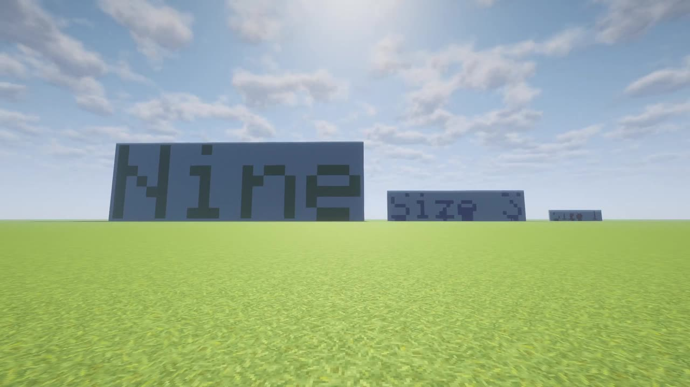
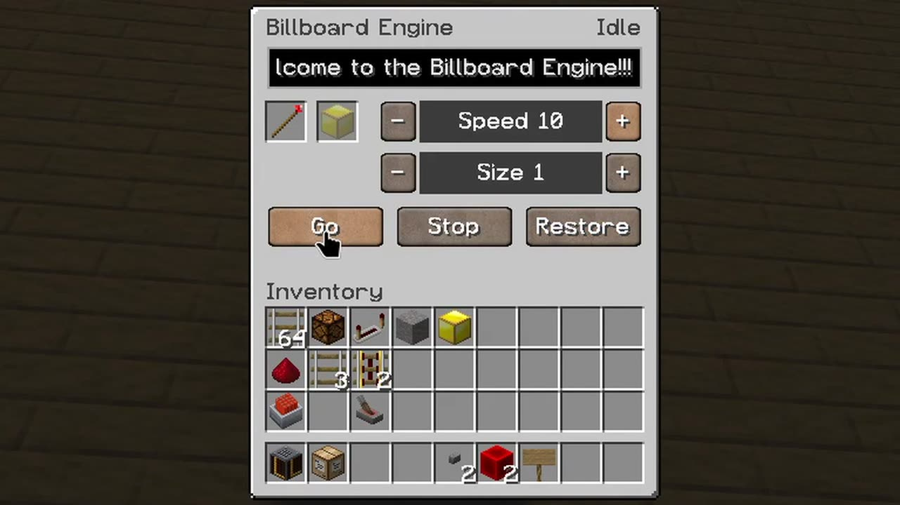
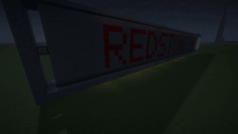
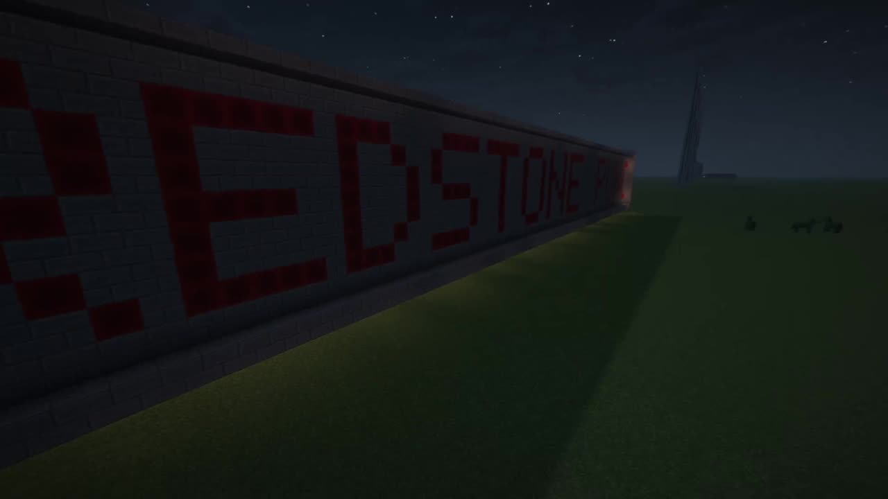
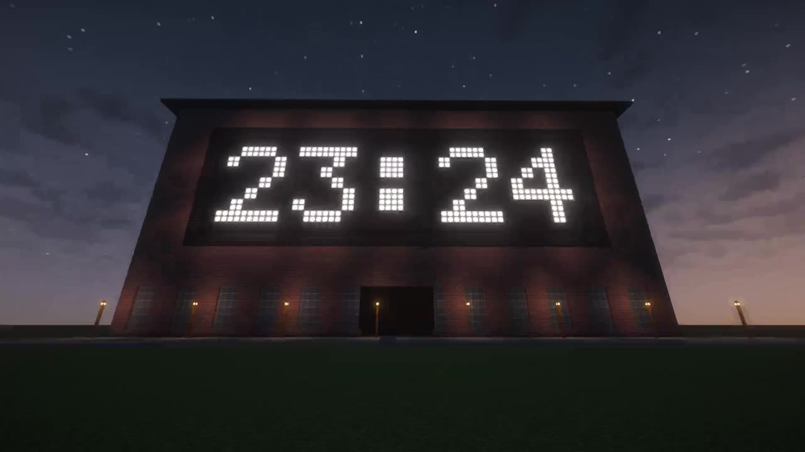
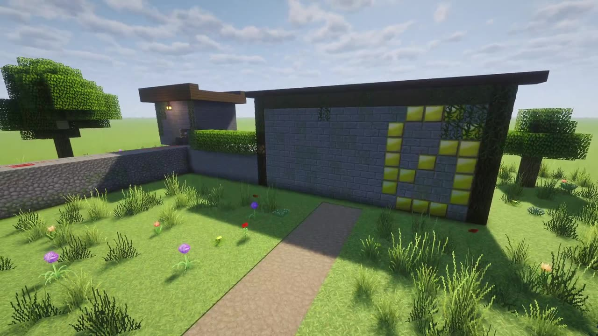
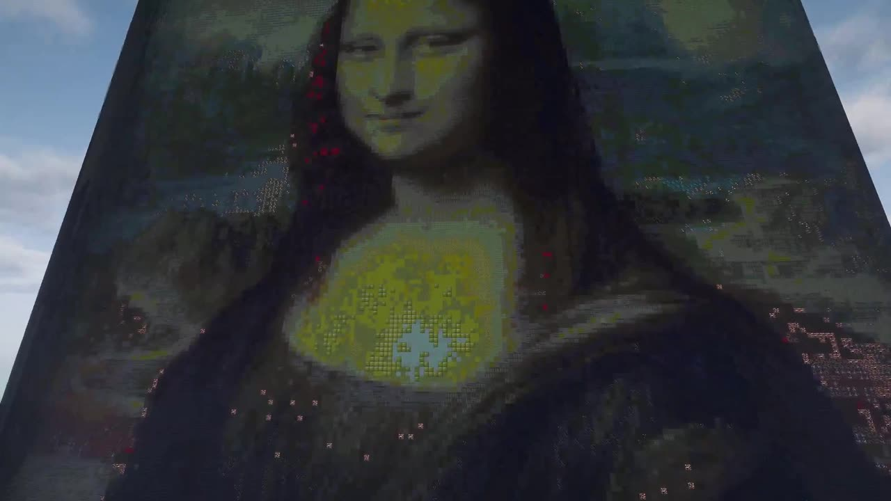
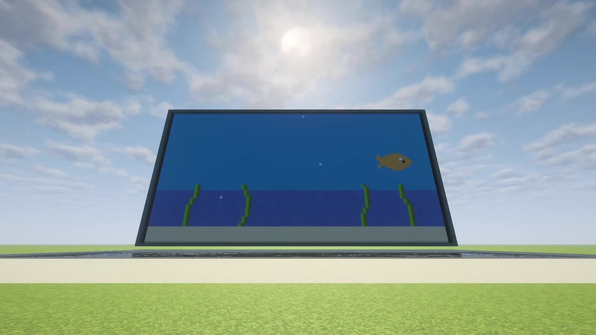

Everything you see here is made of real blocks.

## Trailer

*77 seconds, on YouTube: https://youtu.be/al35hSXC-FU*

## Text

*A town square at dusk. The engine sits hidden behind the wall.*

*Scrolling text, any full block as the pixel.*

*[Letters in 9 sizes](Letters-and-sizes).*

*[The engine screen](The-engine-screen): wand, pixel block, text, speed, size.*

## Redstone

*The [redstone punch card](Redstone-punch-card): lamps behind the wall follow the text.*

## Scripting

*The [Lua Box](Lua-Box): drop `main.lua` and images on it. It comes with Billboard API, CC: Tweaked is not needed.*

*A [clock](Examples#clock) in a few lines of Lua.*

*The [countdown launch show](Examples#countdown-launch-show): one engine, one Lua Box, fireworks at zero.*

## Pictures and animations

*[Pictures](Pictures-and-animations): every pixel becomes the vanilla block with the closest color.*

*Close-up: each pixel is one vanilla block, chosen by its color.*

*An animated GIF playing by itself.*
