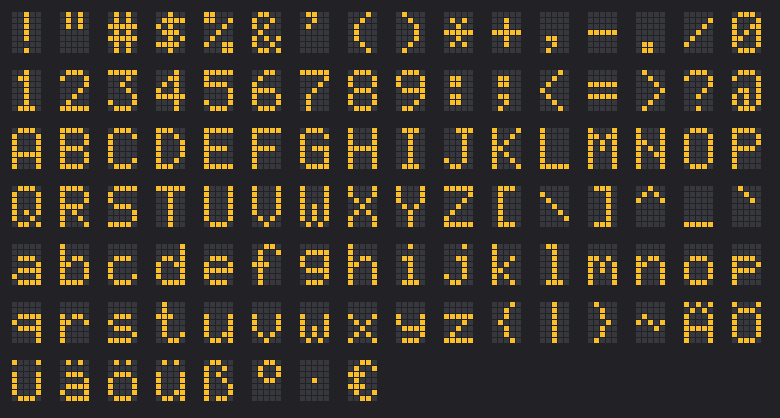

All text uses one 5x7 font: every letter is 5 dots wide and 7 dots high, with one empty column between letters.

## Characters

- Letters `A-Z` and `a-z`, digits, and all ASCII punctuation: `! " # $ % & ' ( ) * + , - . / : ; < = > ? @ [ \ ] ^ _ { | } ~` and the backquote.
- German umlauts `Ä Ö Ü ä ö ü ß`, the degree sign `°`, the euro sign `€`.
- The **middle dot** `·`: exactly one dot in the middle row. Handy as a single moving pixel, see the
  launch show in [Examples](Examples). From Lua write it as `"\183"`.
- Any other character shows as `?`.

## Sizes

**Size** 1 to 9 makes every dot of the font n x n blocks:

| Size | One letter (blocks) | Text height |
| ---: | --- | ---: |
| 1 | 5 x 7 | 7 |
| 2 | 10 x 14 | 14 |
| 3 | 15 x 21 | 21 |
| 5 | 25 x 35 | 35 |
| 9 | 45 x 63 | 63 |

A text is `6 x letters - 1` columns wide at size 1, times the size. `HELLO` is 29 columns at size 1, 87 at size 3.

## Wall height

- On a **taller** wall the text is centered vertically.
- On a **lower** wall the bottom rows are cut off. The engine does not refuse it: you see the result and can
  mark the wall again, or pick a smaller size.

## Speed and size

Speed counts block columns per second. Bigger letters have more columns, so the same speed moves them across
the wall more slowly. That is on purpose: raise the speed if a big text feels slow.
