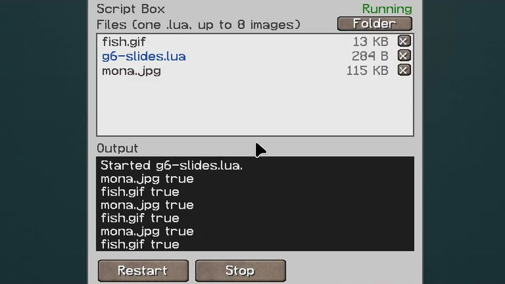

The **Lua Box** runs one Lua program that drives the engine. Since Billboard Engine 2.0 it comes with
[Billboard API](https://github.com/Knito58/Billboard-API), an optional extra mod: put its jar into the `mods` folder when you want Lua. The box, its screen and its settings are described there;
this page is about the engine side.



## Setting it up

1. Install Billboard API next to Billboard Engine.
2. Craft the box: 4 iron, 4 redstone, 1 paper in the middle (the engine recipe with paper instead of the glass pane).
3. Place it so it touches the engine, or join box and engine with **Data Pipes** from Billboard API.
   The engine needs its wand and wall as usual ([Getting started](Getting-started)).
4. Write the program in any text editor on your computer and save it as `main.lua`.
5. Right-click the box and drag the file from your file manager onto its screen. The program starts at once.
   Images for `engine.drawImage("name.png")` are dropped onto the box the same way.

## The engine in a program

- `engine` is the one Billboard Engine the box reaches. With more than one engine in the network, use
  `network.find("billboard:engine")` or name them in the box's Network view and use `network.findByName(name)`.
- Every function in the [Lua reference](Lua-reference) works on `engine` and on such a handle.
- `engine.claim()` makes this box the only one allowed to change the engine: see [Sharing an engine](Sharing-an-engine).
- A box drives any engine it reaches. With `network_owner_check=true` in `config/billboard_api.properties`, a box
  drives only engines placed by the same player.

## Worlds from Billboard Engine 1.x

Script Boxes become Lua Boxes. Each keeps its files, and its program is renamed to `main.lua`. Old programs that use
`engine` run as before. `/billboard script` is now `/luabox <x y z> restart|stop|status`, and the Script Box
settings moved from `billboard.properties` to `billboard_api.properties` (taken over at the first start).

This only happens with Billboard API installed. Open such a world without it and the Script Boxes are removed from
the world; their files stay in `<world>/billboard/scripts/`, but the blocks don't come back.

## A first program

```lua
-- main.lua: the server's time, standing still on the wall
engine.claim()
while true do
  engine.show(os.date("%H:%M"))
  sleep(1)
end
```

More programs: [Examples](Examples).
