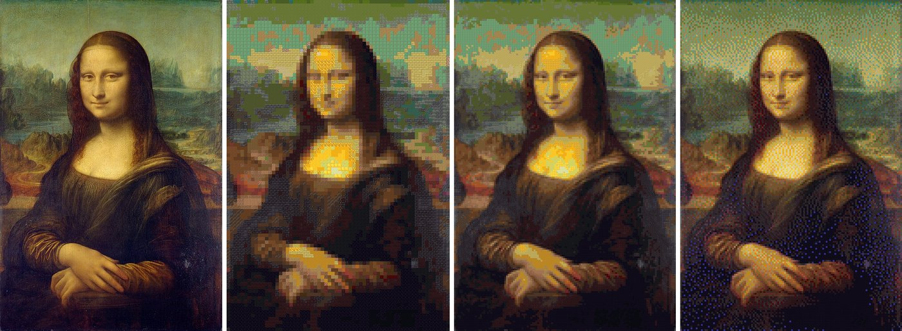
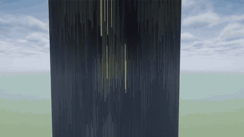
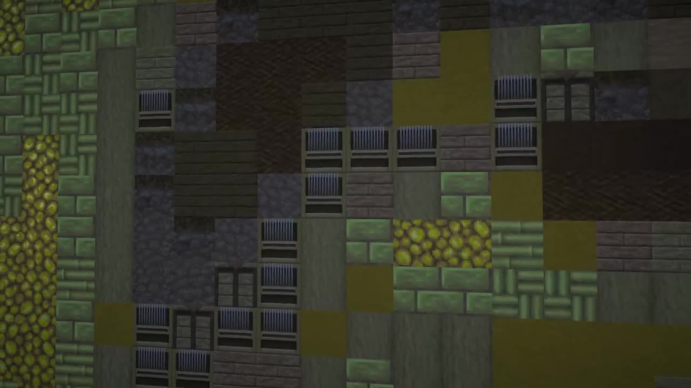

The engine can show an image on its wall. Every pixel becomes the block whose color comes closest.
Animated GIFs play by themselves.



*Left the original, then previews computed from the block textures at growing wall widths.*




A 200 x 298 wall building up, and a close-up from a few blocks away.

## What you need

- The engine with its wand (the marked wall). No pixel block and no text.
- An image: PNG, JPEG, GIF or BMP.
- A program: the [Lua Box](Lua-Box) (drop the image onto the box) or a CC: Tweaked computer
  (image from its disk or from the internet).

```lua
-- Lua Box: mona.png was dropped onto the box
engine.claim()
local ok, reason = engine.drawImage("mona.png", { fit = "fill", dither = true })
print(ok, reason)
```

```lua
-- CC: Tweaked: from the computer's disk, or from the web
local engine = peripheral.find("billboard_engine")
local file = fs.open("mona.png", "rb")
local data = file.readAll() file.close()
-- local data = http.get("https://example.com/cat.gif", nil, true).readAll()
print(engine.drawImage(data))
```

Options (`fit`, `dither`, `loop`) and the other picture functions are in the [Lua reference](Lua-reference#pictures).

## How big?

A face is recognizable at 64 blocks wide and looks good from 128 up. Walls can be up to 256 x 384,
or 512 wide with `max_width` in [the settings](Commands-and-settings).

## The blocks

About 260 plain vanilla blocks are used: wool, concrete, terracotta, planks, logs, stones, ores, metal blocks and more.
All for free, like the pixel block of a text.

Only blocks that are full, opaque, have no block entity, do not fall, tick, glow or give redstone power are used.
So no grass, no copper that oxidizes, no sand, no glowstone. A few more are left out by the block tag
`billboard:not_for_pictures` (TNT, pumpkin heads, sponge, bedrock, redstone lamps, copper bulbs ...). A data pack
can add blocks to that tag.

The colors were measured from the vanilla textures. Resource packs don't change the choice, and blocks from
other mods are not used.

## Colors

Blocks can't be as bright and saturated as a screen. Pure red (255, 0, 0) ends up as orange concrete; red concrete
is about (142, 32, 32). Pictures with soft, natural colors work best. Raise the contrast a little before you use
an image, and try `dither = true` for still pictures.

Transparent parts of an image keep the wall's own blocks. So does alpha below 128 in `drawPixels`.

## How fast?

Only blocks that change are set, at most `blocks_per_tick` (8192) per tick. A new picture on a big wall builds up
over a few ticks, about a second for 512 x 384. A new picture on the same wall replaces the old one without
showing the original wall in between.

Big animations are limited by your computer redrawing the changed chunks, not by the server. Small or mostly still
animations run at their full speed; one that changes all of a 256 x 256 wall manages a few frames per second.

## Limits

- File up to 16 MB (Lua Box: 2 MB per image by default), image up to 4096 x 4096.
- All frames together up to 16 million wall pixels: a 256 x 256 wall takes 256 frames.
- A CC computer's disk holds 1 MB unless raised in the CC: Tweaked config, so bigger files come over `http`.

## After a restart

The picture is not saved with the engine. After a world restart the wall keeps the last picture (still protected,
Restore works), but an animation stands still. A Lua Box simply starts its program again and shows it anew;
on CC put the program into `startup.lua`.
